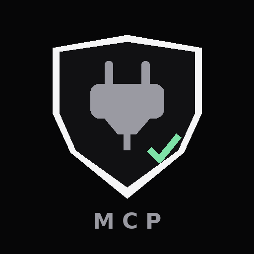

# Agent & MCP Security Auditor

**Is your AI agent safe to ship?** An AI-agent skill for Claude Code, Codex, Cursor and Gemini CLI that audits AI agent apps and
MCP servers for prompt injection (hidden instructions in tool descriptions and agent files), leaked secrets, over-wide permissions
and auto-approval, and unsafe tool calls (command / argument injection, path traversal, SSRF, SQL and code injection).
A local script finds the candidates; your agent judges each one and adds what no script can see; every verdict must quote the exact
code, and a second command rejects quotes that are not really there.

**[Get it on Agensi ($19)](https://www.agensi.io/skills/agent-mcp-security-auditor-is-your-ai-agent-safe-to-ship)** · **[Results page](https://m-shahmeer-kz.github.io/agent-mcp-security-auditor/)**

This repository is the public showcase: true test results, every verdict and report from the blind test, and a real example audit.
The skill itself is sold on Agensi.

## Tested results

| Test | Result |
|---|---|
| **Blind test on 24 real MCP security advisories** (chosen and sealed by a separate agent with fixed rules; v1.0.0 frozen; 15 fresh AI agents ran the full skill on 45 checkouts, before and after each fix, without being told what to look for) | **21/24** caught and confirmed (checked by hand; a strict automatic count gives 20/24), 1 more found but marked "needs context", 2 missed |
| Same advisories, the code **after** the developers' fix | not flagged again in **15/21**; of the 6 flagged again, 2 are real holes the fix left behind, 3 are real gaps in the new URL checks, 1 is arguable |
| Scanner alone (no AI review) on the same 24 | 7/24: the agent's review does most of the work |
| **Poisoned tool descriptions**: MCPTox (AAAI 2026), 27 servers never looked at, 991 descriptions | normal: **635/793** caught (80.1%), **1/198** clean flagged; sensitive: 765/793 (96.5%), 5/198 |
| **Buyer test**: realistic LangGraph support agent + TypeScript billing MCP server, 12 planted problems + 9 safe look-alikes, expectations written first | **12/12** found, **0/9** decoys confirmed |

All 45 blind audits passed the quote check. Every advisory, verdict, report and the scoring script are in [`results/`](results/).
Version history: 1.0.0 was blind-tested; 1.0.1 fixed problems the test found (very large repos now scan in under a minute instead of
timing out, manual-only audits, report locations, fewer alarms on example values in API specs); 1.0.2 masks secrets in the agent's working file too
(found in the buyer test). Hashes of each version are in `results/FREEZE_v*.txt`.

## What it does
1. **Scan**: MCP client configs (Claude, Cursor, VS Code, Windsurf, Gemini, Codex, Zed…), agent permission settings, MCP servers and agent code in
   Python and TypeScript/JavaScript (input followed across files and helper functions), tool definitions, agent instruction files, secrets.
2. **Tool lists**: scores a `tools/list` export or pasted descriptions for hidden instructions.
3. **Review**: your agent judges every candidate with the guide (is the input attacker-controlled, does the guard really work).
4. **Manual pass**: authorization on every tool, token passthrough, destructive tools without confirmation, untrusted text reaching the model,
   the "lethal trifecta" (untrusted input + private data + a way out).
5. **Verify**: every quote must exist at the cited line; injection findings need two quotes (where the input enters and where it is used).
6. **Report**: verdict, fixes in order, dismissed items with the code that makes them safe, OWASP Top 10 for Agentic Applications (2026) mapping, SARIF for
   GitHub code scanning; optional `pin` catches tool definitions that change later ("rug pull").

Standard library only (Python 3.10+). Local and read-only: it never runs, installs or connects to what it audits, and never sends anything
over the network. Secrets are masked in every output.

## Examples
- [`examples/support-agent-app/`](examples/support-agent-app/): the full report and SARIF from the buyer test.
- [`results/cve_holdout/agent_runs/`](results/cve_holdout/agent_runs/): the 45 blind audits (verdicts, verified findings, reports).

## Limits
Static review: it cannot see runtime behaviour or what remote MCP servers return later (use `pin` in CI for that). It missed 2 of 24 advisories
(an `eval` of model output and an attachment download path). The judge is an AI; a human should confirm critical fixes.

Made by [Muhammad Shahmeer](https://m-shahmeer-kz.github.io/) · © 2026, all rights reserved.
MCPTox © its authors, CC BY 4.0 ([github.com/zhiqiangwang4/MCPTox-Benchmark](https://github.com/zhiqiangwang4/MCPTox-Benchmark)); only scores,
the split and the scripts are published here. Advisories from the GitHub Advisory Database; audited projects © their authors (short quotes only).
The token in `results/buyer_test/app/.mcp.json` is fake. Not affiliated with OWASP, GitHub or the MCP project.
